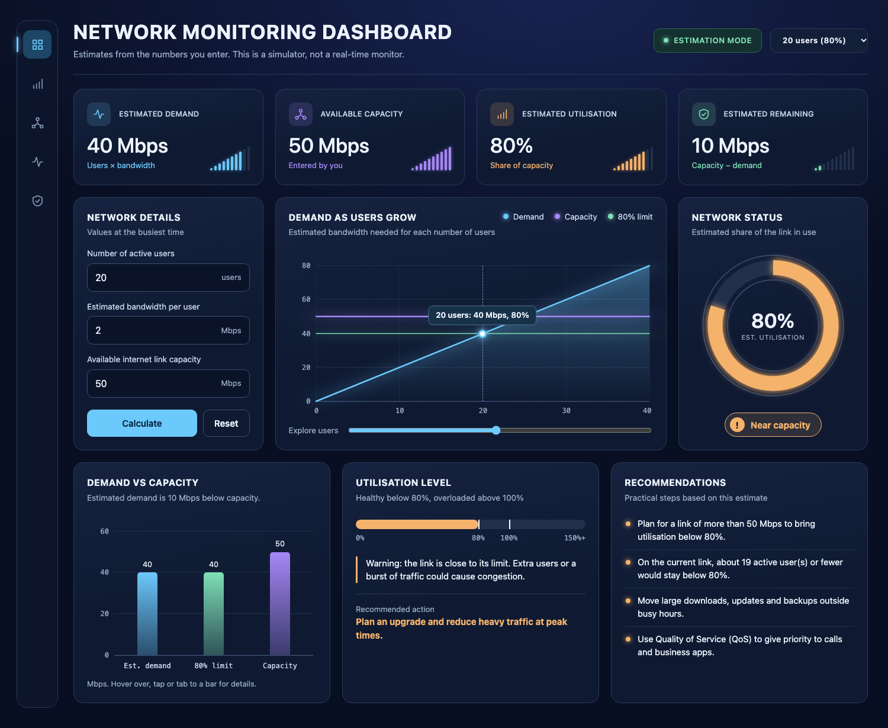

# Network Monitoring Dashboard

An interactive dashboard that estimates whether an office internet connection can support its peak number of users. Built as an undergraduate networking project.

> **Note:** this is a network capacity **estimation simulator**, not a real-time monitoring system. It does not measure live traffic. All calculated values are estimates based on the numbers entered.

## Features

- Estimated demand, utilisation and remaining bandwidth or shortage
- Green, orange or red network status, with warnings and recommendations
- Line chart of demand as users grow, with a slider to explore different user numbers
- Bar chart comparing demand, the 80% limit and capacity
- Utilisation progress bar and status ring
- Input validation with clear error messages
- Simple explanations of bandwidth, throughput, congestion and capacity
- Built-in tests that run in the browser

## Technologies

HTML5, CSS3 and vanilla JavaScript. No frameworks, libraries, APIs, databases or servers. It works offline.

## How to run

1. Download or clone this repository.
2. Open `index.html` in a modern desktop browser.

In VS Code: choose **File > Open Folder**, select the project folder, then open `index.html` from your file manager. The Live Server extension also works but is not required.

The layout is designed for desktop screens.

## Formulas

Example: 20 users, 2 Mbps per user, 50 Mbps link.

| Formula | Example |
|---|---|
| Estimated demand = Users × Bandwidth per user | 20 × 2 = 40 Mbps |
| Estimated utilisation (%) = (Demand ÷ Capacity) × 100 | (40 ÷ 50) × 100 = 80% |
| Remaining bandwidth = Capacity − Demand | 50 − 40 = 10 Mbps |

| Estimated utilisation | Status |
|---|---|
| Below 80% | 🟢 Healthy |
| 80% to 100% | 🟠 Near capacity ("Full capacity" at exactly 100%) |
| Above 100% | 🔴 Overloaded |

## Input rules

| Input | Allowed values |
|---|---|
| Active users | Whole numbers from 1 to 100,000 |
| Bandwidth per user | 0.01 to 10,000 Mbps |
| Link capacity | 0.01 to 1,000,000 Mbps |

## Testing

Select **Run all tests** at the bottom of the page. There are 11 tests, including:

| Users | Mbps per user | Capacity (Mbps) | Expected result |
|---|---|---|---|
| 10 | 2 | 50 | Healthy, 40% |
| 20 | 2 | 50 | Near capacity, 80% |
| 25 | 2 | 50 | Full capacity, 100% |
| 30 | 2 | 50 | Overloaded, 120% |
| 10 | 2 | 0 | Validation error |
| -5 | 2 | 50 | Validation error |

Tested in Google Chrome on macOS.

## Project files

| File | Purpose |
|---|---|
| `index.html` | Page structure and content |
| `style.css` | Colours, layout and charts |
| `script.js` | Validation, calculations, charts and tests |

## Limitations

- Assumes every user needs the same bandwidth at the same time.
- Does not include latency, jitter, packet loss, protocol overhead or Wi-Fi quality.
- Does not separate upload and download traffic.
- The 80% limit is a planning guideline and can vary between networks.
